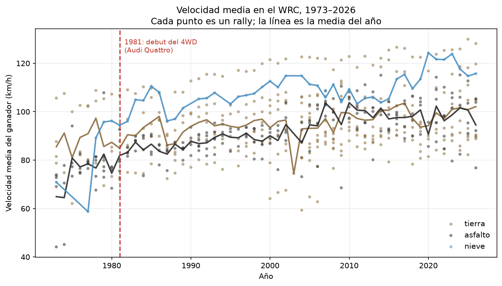
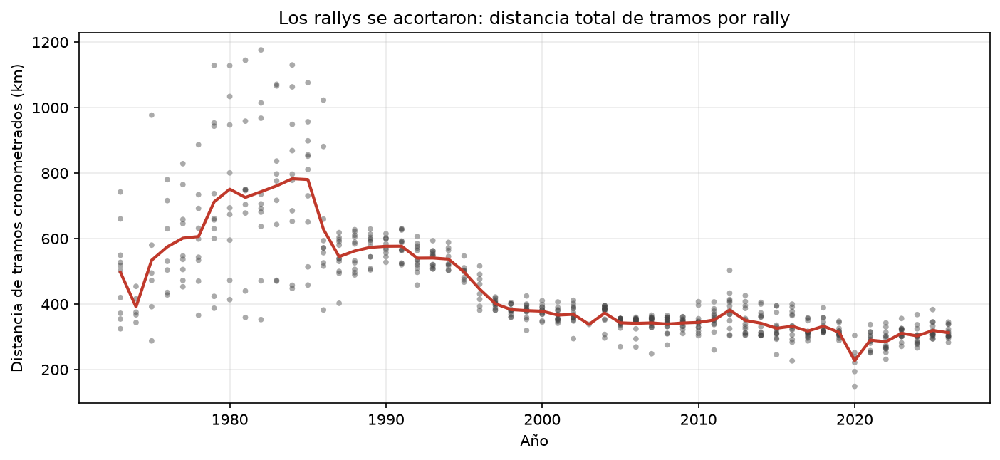
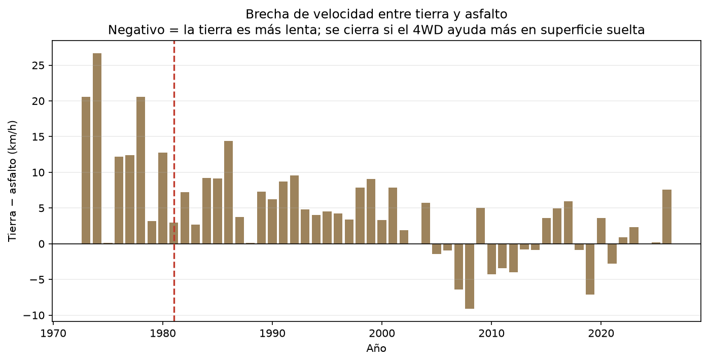

# 50 años de velocidad en el WRC

Analicé 633 rallys del campeonato del mundo entre 1973 y 2026 para ver cuánto se
aceleró el deporte de verdad, y cuánto del cambio es en realidad que los rallys
se hicieron más cortos.

Los datos salen de [juwra.com](https://www.juwra.com), un archivo independiente
del WRC. No hay cifras estimadas a mano ni datos generados.

## Por qué me interesó

El rally se corre sobre caminos públicos en vez de un circuito. Eso deja medio
siglo de tiempos oficiales medidos sobre terrenos que no se pueden reproducir en
un laboratorio, y no conozco otro deporte con ese tipo de registro.

Compararlos es más difícil de lo que parece. Un rally de 1973 tenía 574 km
cronometrados de media; uno de 2026 tiene 298. Los coches cambiaron de motor, de
neumáticos y de reglamento varias veces. La era del Grupo B se canceló en 1986
después de varios accidentes mortales, y con ella desapareció el coche más rápido
que el campeonato tuvo.

Con ese panorama, cualquiera puede afirmar que los rallys de hoy son más rápidos
y nadie tiene cómo discutirlo. Pero si el número sube 25%, vale la pena saber
cuánto de ese 25% es velocidad y cuánto es que el recorrido se acortó.

## La pregunta

La principal era cuánto más rápido es un rally hoy que en 1973, y si eso aguanta
al controlar por la longitud del recorrido.

De ahí salieron tres más. En qué superficie se notó más el cambio, si cambió algo
además de la velocidad, y si la llegada del 4WD en 1981 fue la causa del salto de
los ochenta.

## Los datos

| | |
|---|---|
| Fuente | juwra.com, archivo independiente del WRC |
| Periodo | 1973 a 2026 |
| Rallys recolectados | 633 de 682 en calendario (93%) |
| Rallys que pasan el control de calidad | 609 |
| Variables | superficie, km cronometrados, inscritos, finalizados, tiempo del ganador |

De cada rally guardo lo mínimo verificable. La velocidad media es distancia entre
tiempo, sin ajustes. La superficie no la clasifiqué yo: el archivo la publica en
la ficha de cada rally y la usé tal cual, porque una clasificación propia habría
metido mi criterio dentro del resultado.

## Los resultados

### La velocidad subió 24.6%, pero un tercio de eso es el calendario



El ganador promedia 101.1 km/h entre 2020 y 2026, contra 81.2 km/h entre 1973 y
1979. Son 19.9 km/h de diferencia.

El caso es que los rallys también se acortaron, de 574 km de tramos en los setenta
a 298 en los veinte, y la longitud tiene relación negativa con la velocidad media
(Pearson −0.368): a más kilómetros cronometrados, menor promedio.



Si comparo solo rallys de longitud parecida, entre 250 y 400 km de tramos, la
mejora baja a 16.5 km/h. Es decir, un tercio de la cifra original era el recorte
del recorrido y no el coche.


### La nieve pasó de la más lenta a la más rápida



| Superficie | 1973–1979 | 2020–2026 | Cambio |
|---|---:|---:|---:|
| Nieve | 78.6 km/h (n=4) | 119.9 km/h (n=7) | +41.3 |
| Asfalto | 75.9 km/h (n=30) | 98.4 km/h (n=28) | +22.5 |
| Tierra | 88.7 km/h (n=22) | 100.0 km/h (n=50) | +11.2 |

En los setenta la nieve era la superficie más lenta del campeonato. Ahora es la
más rápida, casi 20 km/h por encima del asfalto. Es el cambio más grande de los
tres y apunta a que la tracción y los neumáticos de clavos avanzaron más que la
potencia, lo cual tiene sentido: en nieve el motor nunca fue el límite.

Dicho eso, el tamaño de muestra es de 4 rallys en los setenta y 7 hoy. El signo
del cambio es consistente porque las décadas intermedias van en la misma
dirección, pero la magnitud tiene un intervalo amplio. Con esos números, defender
"+41 km/h" como cifra precisa es pedirle a los datos más de lo que dan.

### La fiabilidad se multiplicó

Porcentaje de inscritos que terminan el rally:

```
1973–1990   39.6%   (n=166)
1991–2009   55.3%   (n=228)
2010–2026   71.3%   (n=215)
```

En los setenta seis de cada diez coches no terminaban. Hoy terminan siete de cada
diez. Es el cambio más grande del proyecto y no tiene nada que ver con la
velocidad; es ingeniería de fiabilidad.

## La hipótesis del 4WD no se sostuvo

Mi plan original era usar la llegada del Audi Quattro en 1981 como experimento
natural. Si la tracción total ayuda más donde el suelo está suelto, el salto de
velocidad debería haber sido mayor en tierra que en asfalto, y el asfalto servía
de control para todo lo demás que mejoró al mismo tiempo.


Los datos no lo respaldan.

```
asfalto  1975-80: 78.62 (n=27)  →  1982-87: 84.60 (n=24)   Δ = +5.97
tierra   1975-80: 89.06 (n=19)  →  1982-87: 92.21 (n=30)   Δ = +3.15
DiD (tierra − asfalto) = −2.83 km/h   (ee 4.22, t = −0.67)
```

El efecto sale negativo y estadísticamente indistinguible de cero. Mirando el dato
con más cuidado se entiende por qué: en 1973 la tierra ya era 13 km/h más rápida
que el asfalto. Las dos superficies no son comparables de entrada. Los rallys de
asfalto del calendario clásico, como el Tour de Corse o Montecarlo, son trazados
lentos y revirados, mientras que los de tierra incluyen Finlandia, que es de las
cosas más rápidas del calendario. Usarlas como grupo de tratamiento y control no
identifica nada.

Dejé el resultado negativo escrito en vez de buscar el corte de años que sí diera
significativo. Escoger la ventana después de ver los datos es la forma más fácil
de fabricar un hallazgo que no existe.

## Cómo lo hice

```
juwra.com/calendar_<año>.html        → rallys de la temporada
juwra.com/<slug>_<año>.html          → superficie, distancia de tramos, inscritos, finalizados
juwra.com/<slug>_<año>_results.html  → ganador y tiempo total
```

El sitio exige un `User-Agent` de navegador; sin él devuelve HTML vacío. El
scraper es idempotente, así que se puede cortar a la mitad y retomar sin duplicar
filas.

De los 633 rallys, 609 pasan el filtro y 24 se descartan con el motivo registrado:

```
distancia_imposible    19   (menos de 50 km o más de 1200 km de tramos)
velocidad_imposible     5   (fuera del rango físico 40–160 km/h)
superficie_desconocida  0
```

No corregí ninguna fila a mano. Se descarta y se reporta el descarte.

### Para reproducirlo

```bash
python -m venv .venv && .venv/bin/pip install -r requirements.txt
.venv/bin/python -m src.ingest --desde 1973 --hasta 2026   # ~15 min, idempotente
.venv/bin/python run_analysis.py                            # figuras + reports/resultados.json
```

Todas las cifras de este documento salen de `reports/resultados.json`, que genera
`run_analysis.py`. Ninguna está escrita a mano.

### Qué hay en cada archivo

| Archivo | Qué hace |
|---|---|
| `src/ingest.py` | Recolecta los 633 rallys. Idempotente |
| `src/metrics.py` | Velocidad, tasa de finalización, contraste 1981, control por longitud |
| `src/charts.py` | Las cinco figuras |
| `run_analysis.py` | Pipeline completo, escribe `reports/resultados.json` |

## Limitaciones

Solo tengo un dato por rally, el del ganador. No hay información de coche,
neumático ni condiciones, así que todo lo que digo es sobre el ganador y no sobre
la parrilla.

La velocidad media también depende del trazado y no solo del coche. Un rally
puede ser rápido porque su recorrido es rápido. El control por longitud reduce el
problema pero no lo elimina, porque sigo sin controlar el diseño del recorrido.

La composición del calendario cambió demasiado. En 1973 había rallys de 1,258 km
de tramos como Marruecos, y hoy el más largo no llega a 400. Comparar medias de
épocas distintas es comparar calendarios distintos.

La cobertura es del 93%. De 682 rallys en los calendarios recolecté 633; el resto
no publica la distancia cronometrada. La diferencia varía por año: en 1973 entraron
11 de 13 y en 2024 entraron los 13.

Los rallys mixtos quedan fuera del análisis por superficie. Montecarlo y los que
combinan asfalto y nieve se descartan en ese corte porque su media mezcla dos
regímenes de adherencia distintos.

La nieve tiene muestra pequeña, 4 y 7 rallys. El signo del cambio es consistente,
la magnitud no es precisa.

Excluí los rallys maratón. Costa de Marfil entre 1976 y 1985 tuvo entre 4,000 y
5,622 km cronometrados sin tramos, porque contaba el recorrido entero. Son datos
reales y no errores, pero comparar su media con la de un rally de 300 km no mide
lo mismo. Están entre las 19 filas descartadas por distancia.

## Lo que estos datos no permiten afirmar

Que el 4WD causara el aumento de velocidad. El contraste de 1981 no lo identifica
y está reportado como resultado negativo.

Que los coches de hoy sean mejores que los de 1973. Mido velocidad media del
ganador en un rally, que es otra cosa.

Que la nieve sea la superficie más rápida del WRC en general. Es la más rápida
entre los rallys de nieve que están en el calendario, que son pocos y recientes.

## Fuente y licencia

`juwra.com` es un archivo independiente del WRC que mantiene Jonkka desde 1973.
No es un sitio oficial de la FIA. Los datos se extraen de páginas HTML públicas,
sin API, y cada fila guarda la URL del rally del que salió.

El código es MIT. Los datos pertenecen a su fuente; este repositorio publica el
conjunto derivado con la atribución correspondiente.
