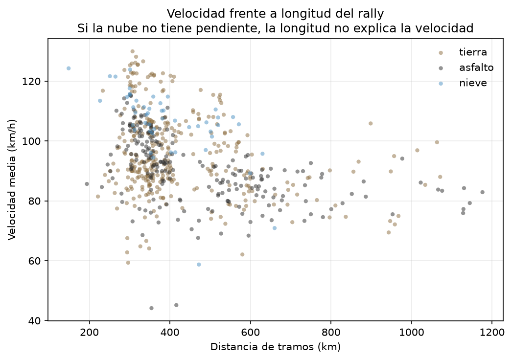
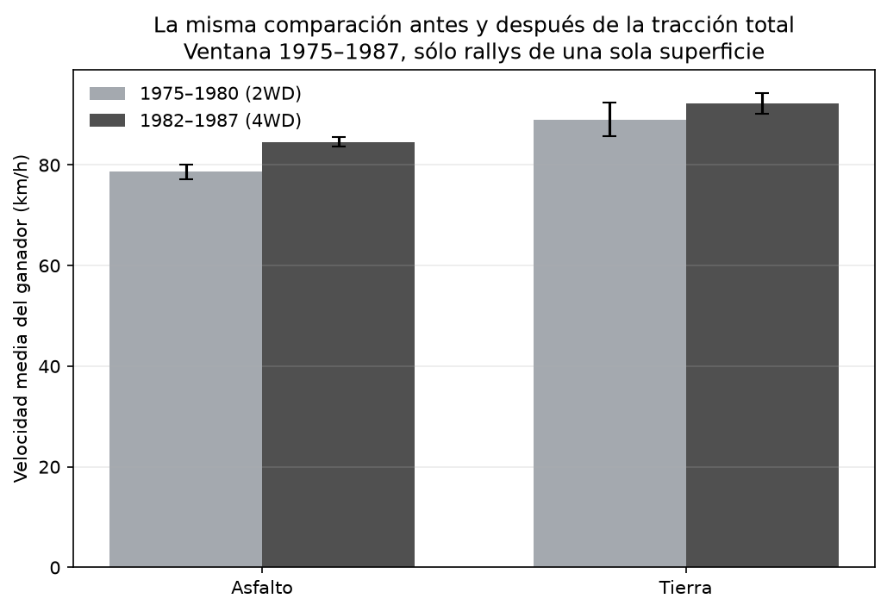

# 50 años de velocidad en el WRC

**Un análisis de 633 rallys del campeonato del mundo entre 1973 y 2026, para medir
cuánto se aceleró el deporte, en qué superficie se notó más y qué parte de esa
mejora es real y qué parte es un artefacto de cómo cambió el calendario.**

Datos reales extraídos de [juwra.com](https://www.juwra.com), archivo independiente
del WRC. Sin datos simulados ni cifras estimadas a mano.

---

## El problema

El rally es la única disciplina del automovilismo donde el cronómetro se toma
sobre caminos públicos, no sobre un circuito. Eso lo hace un registro excepcional:
cincuenta años de tiempos oficiales sobre terrenos que no se pueden repetir en un
laboratorio.

Y también lo hace difícil de comparar. Un rally de 1973 recorría 574 km
cronometrados de media. Uno de 2026 recorre 298. Los coches cambiaron de
propulsión, de neumáticos y de reglamento varias veces: la era del Grupo B
(1982–1986) terminó cancelada tras una serie de accidentes mortales, y con ella
se fue el coche más rápido que el campeonato haya tenido.

La consecuencia es que cualquiera puede afirmar que "los rallys de hoy son más
rápidos" y nadie tiene con qué discutirlo. Y si el número sube un 25%, la pregunta
interesante no es cuánto subió, sino **cuánto de ese 25% es velocidad de verdad y
cuánto es que los rallys se hicieron más cortos**.

## La pregunta

- **Principal:** ¿cuánto más rápido es un rally hoy que en 1973, y ese cambio
  sobrevive a controlar por la longitud del recorrido?
- **Secundaria 1:** ¿en qué superficie se notó más el cambio?
- **Secundaria 2:** ¿cambió algo además de la velocidad? La fiabilidad, por
  ejemplo.
- **Hipótesis a contrastar:** que la llegada de la tracción total (Audi Quattro,
  1981) sea la causa del salto de los años 80.

## Los datos

| | |
|---|---|
| Fuente | `juwra.com`, archivo independiente del WRC (no oficial de la FIA) |
| Cobertura | 1973–2026 |
| Rallys recolectados | **633** de 682 en calendario (93%) |
| Rallys que pasan el control de calidad | **609** |
| Variables | superficie, km cronometrados, inscritos, finalizados, tiempo del ganador |

De cada rally se guarda el mínimo verificable. La velocidad media es distancia
entre tiempo, sin ningún ajuste. La superficie **no se clasificó a mano**: el
archivo la publica en la ficha de cada rally (`Surface: Gravel / Asphalt / Snow`)
y se usa tal cual, para no meter una decisión editorial dentro del resultado.

---

## Los resultados

### 1. La velocidad subió 24.6%, pero un tercio de eso es el calendario


El ganador promedia **101.1 km/h entre 2020 y 2026**, contra **81.2 km/h entre
1973 y 1979**. Son **+19.9 km/h**.

Pero los rallys se acortaron de **574 km de tramos en los 70 a 298 km en los 2020**,
y la longitud correlaciona negativamente con la velocidad media (**Pearson
−0.368**): a más kilómetros cronometrados, menor media.


Comparando solo rallys de longitud parecida (250–400 km de tramos), la mejora es
de **+16.5 km/h**, no de +19.9. Un tercio de la cifra cruda era el recorte del
recorrido.



### 2. La nieve pasó de la más lenta a la más rápida


| Superficie | 1973–1979 | 2020–2026 | Cambio |
|---|---:|---:|---:|
| Nieve | 78.6 km/h (n=4) | **119.9 km/h** (n=7) | **+41.3** |
| Asfalto | 75.9 km/h (n=30) | 98.4 km/h (n=28) | +22.5 |
| Tierra | 88.7 km/h (n=22) | 100.0 km/h (n=50) | +11.2 |

En los 70 la nieve era la superficie **más lenta** del campeonato. Hoy es la más
rápida, casi 20 km/h por encima del asfalto. Es el cambio más grande de los tres y
va en la dirección que uno esperaría si la tracción y los neumáticos de clavos
avanzaron más que la potencia: en nieve la limitación nunca fue el motor.

Ojo con el tamaño de muestra: **n=4 en los 70 y n=7 hoy**. El signo del cambio es
sólido (todas las décadas intermedias van en la misma dirección), pero la magnitud
tiene un intervalo amplio. Con ese n, decir "+41 km/h" es defender más precisión
de la que los datos sostienen.

### 3. La fiabilidad se multiplicó

Porcentaje de inscritos que terminan el rally:

```
1973–1990   39.6%   (n=166)
1991–2009   55.3%   (n=228)
2010–2026   71.3%   (n=215)
```

En los 70 **seis de cada diez coches no terminaban**. Hoy terminan siete de cada
diez. Es el cambio más grande del proyecto y no tiene nada que ver con la
velocidad: es ingeniería de fiabilidad.

---

## Una hipótesis que no se sostuvo

El plan original era usar la llegada del 4WD (Audi Quattro, 1981) como experimento
natural: si la tracción total ayuda más donde el suelo es suelto, el salto de
velocidad debería ser mayor en tierra que en asfalto, y el asfalto serviría de
control de todo lo demás que mejoró a la vez.



**Los datos no lo respaldan.**

```
asfalto  1975-80: 78.62 (n=27)  →  1982-87: 84.60 (n=24)   Δ = +5.97
tierra   1975-80: 89.06 (n=19)  →  1982-87: 92.21 (n=30)   Δ = +3.15
DiD (tierra − asfalto) = −2.83 km/h   (ee 4.22, t = −0.67)
```

El efecto estimado es **negativo y estadísticamente indistinguible de cero**. Y hay
una razón de fondo que el propio dato delata: **en 1973 la tierra ya era 13 km/h
más rápida que el asfalto**. Las superficies no son comparables de entrada —los
rallys de asfalto del calendario clásico (Tour de Corse, Montecarlo) son trazados
lentos y revirados, mientras que los de tierra incluyen Finlandia, que es de las
cosas más rápidas del calendario—, así que usarlas como grupo de tratamiento y
control no identifica nada.

Se deja escrito el resultado negativo en vez de buscar el corte de años que sí dé
significativo. Elegir la ventana después de ver los datos es cómo se fabrica un
hallazgo falso.

---

## Cómo se hizo

```
juwra.com/calendar_<año>.html        → rallys de la temporada
juwra.com/<slug>_<año>.html          → superficie, distancia de tramos, inscritos, finalizados
juwra.com/<slug>_<año>_results.html  → ganador y tiempo total
```

El sitio **exige `User-Agent` de navegador**: sin él devuelve HTML vacío. El
scraper es idempotente, así que se puede cortar y retomar sin duplicar filas.

### Control de calidad

De 633 rallys, **609 pasan el filtro** y 24 se descartan con motivo registrado:

```
distancia_imposible    19   (menos de 50 km o más de 1200 km de tramos)
velocidad_imposible     5   (fuera del rango físico 40–160 km/h)
superficie_desconocida  0
```

No se corrigió ninguna fila a mano: se descarta y se reporta el descarte.

### Reproducir

```bash
python -m venv .venv && .venv/bin/pip install -r requirements.txt
.venv/bin/python -m src.ingest --desde 1973 --hasta 2026   # ~15 min, idempotente
.venv/bin/python run_analysis.py                            # figuras + reports/resultados.json
```

Todas las cifras de este README salen de `reports/resultados.json`. Ninguna está
escrita a mano.

### Estructura

| Archivo | Qué hace |
|---|---|
| `src/ingest.py` | Recolecta los 633 rallys. Idempotente |
| `src/metrics.py` | Velocidad, tasa de finalización, contraste 1981, control por longitud |
| `src/charts.py` | Las cinco figuras |
| `run_analysis.py` | Pipeline completo; escribe `reports/resultados.json` |

---

## Limitaciones

Este es el apartado que hace defendible el resto.

1. **Solo hay un dato por rally: el ganador.** No hay información de coche,
   neumático ni condiciones. Todo lo que se diga es sobre el ganador, no sobre la
   parrilla.
2. **La velocidad media depende del trazado, no solo del coche.** Un rally rápido
   puede serlo porque su recorrido es rápido. El control por longitud reduce el
   problema pero no lo elimina: sigue sin controlar el diseño del recorrido.
3. **La composición del calendario cambió.** En 1973 había rallys de 1,258 km de
   tramos (Marruecos) y hoy el más largo no llega a 400. Comparar medias de épocas
   distintas compara calendarios distintos.
4. **Cobertura del 93%.** De 682 rallys en los calendarios, se recolectaron 633.
   El resto no publica la distancia cronometrada. Diferencia por año visible en
   `data/ingest.log` (1973: 11 de 13; 2024: 13 de 13).
5. **Los rallys mixtos quedan fuera del análisis por superficie.** Montecarlo y los
   que combinan asfalto y nieve se descartan en ese corte, porque su media mezcla
   dos regímenes de adherencia.
6. **La nieve tiene n pequeño** (4 y 7). El signo del cambio es consistente, la
   magnitud no es precisa.
7. **Se excluyeron los rallys maratón.** Costa de Marfil (1976–1985) tuvo entre
   4,000 y 5,622 km cronometrados, sin tramos: el recorrido entero contaba. Son
   datos reales, no errores, pero comparar su media con la de un rally de 300 km no
   mide lo mismo. Están entre las 19 filas descartadas por distancia.

## Lo que no se puede afirmar con estos datos

- Que el 4WD causara el aumento de velocidad. El contraste de 1981 no lo identifica
  y se reporta como resultado negativo.
- Que los coches de hoy sean "mejores" que los de 1973. Se mide velocidad media del
  ganador en un rally, que es una cosa distinta.
- Que la nieve sea la superficie más rápida del WRC en general. Es la más rápida
  **en los rallys de nieve que están en el calendario**, que son pocos y recientes.

---

## Fuente

`juwra.com` — archivo independiente del WRC, 1973 al presente, mantenido por
Jonkka. No es un sitio oficial de la FIA. Los datos se extraen de páginas HTML
públicas, sin API; cada fila guarda la URL del rally del que salió.

## Licencia

Código MIT. Los datos pertenecen a su fuente; este repositorio publica el conjunto
derivado (superficie, distancia y tiempo por rally) con la atribución
correspondiente.
